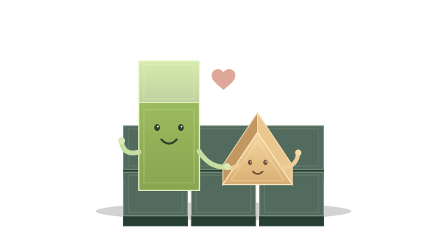

# Block Block — Every Shape Belongs

A gentle story about a father, his triangle son, and finding the way home.

## World 1 · Levels 1–5

### A little triangle, a big feeling

Block loves his triangle son more than anything. But Triangle wonders, “Dad has corners like a block. I look different. Do I belong?” He sets off to find a place where he fits, leaving a little note. Block reads it and follows: “You belong with me, little one.”

## World 2 · Levels 6–10

### Following little footsteps

A neighbor saw Triangle heading toward the ocean, looking for shapes like his own. Block follows the path. He wants to tell his son something simple: families do not have to look alike to belong together.

## World 3 · Levels 11–15

### A message in the sand

Beside the water, Block finds a triangle drawn in the sand. He draws a block beside it and a heart around them both. “Different shapes. Same family,” he says, and keeps looking.

## World 4 · Levels 16–20

### Room to grow

Triangle has stopped in a garden full of tall and tiny plants. Block learns to change size as he crosses it. Big or small, he is still Dad. And wherever Triangle goes, he will still be his son.

## World 5 · Levels 21–25

### Making a way

A friendly traveler points toward the bridges. “Your little triangle helped me find my way,” they tell Block. Block smiles. His son has always had a kind heart.

## World 6 · Levels 26–30

### A bridge between us

Across the bridges, Block finds another note: “I wish I could be more like you, Dad.” “You never need to change for me,” Block says softly. He carries the note close and rolls onward.

## World 7 · Levels 31–35

### Farther than the horizon

Triangle has followed the shining paths to a new world. Block asks friendly shapes for directions. Each one helps him along. There is room in the world for every shape.

## World 8 · Levels 36–40

### Through the bright doorway

A glowing portal leads Block onward. Before stepping through, he leaves a message for his son: “I love your three corners. I love your big ideas. I love you.”

## World 9 · Levels 41–45

### Small, careful steps

The path ahead needs gentle steps. Block takes his time, remembering how Triangle first learned to hop. They were different steps from his own, and he loved cheering for every one.

## World 10 · Levels 46–50

### A place to rest

Friendly shapes invite Block to rest in their garden. A circle, a square, and a triangle share a picnic. “Belonging is being welcomed,” they say. Block cannot wait to welcome his son home.

## World 11 · Levels 51–55

### The shape of a family

Block finds a drawing Triangle made: the two of them beneath their roof. Triangle has written, “Do I still fit here?” Block knows his answer: “Always. Our home has room for you, exactly as you are.”

## World 12 · Levels 56–60

### Love keeps going

There are still paths to cross, but Block keeps going at his own pace. Each puzzle brings him closer to his son. He practices the words he wants to say: “You are loved. You belong. I am here.”

## World 13 · Levels 61–65

### Look with your heart

Some paths look different when Block turns around. He remembers all the things he and Triangle share: silly songs, bedtime stories, and warm hugs. None of those things need matching corners.

## World 14 · Levels 66–70

### A familiar little song

A familiar song drifts across the next world. It is the tune Block and Triangle hum together at home. Block follows with a smile, humming his part so his son might hear.

## World 15 · Levels 71–75

### Almost close enough

Triangle hears a familiar hum. Could Dad have come all this way for him? He leaves a bright ribbon on the path. Block recognizes it from their favorite kite and follows it onward.

## World 16 · Levels 76–80

### Your very own shape

Block meets a friend who has been talking with Triangle. “He thinks he needs four corners to make you proud.” Block shakes his head gently. “I am already proud of him. Three corners and all.”

## World 17 · Levels 81–85

### A message finds its way

The friend carries Block’s words ahead: “You are my son. I love you just as you are.” Triangle reads the message twice, then smiles a little. Maybe home was his place all along.

## World 18 · Levels 86–90

### Waiting by the garden

Triangle sends a note back: “I’m by the garden. Can we go home together?” “Of course,” says Block. The last paths wind toward a quiet place where they can talk and share a hug.

## World 19 · Levels 91–95

### No need to be the same

Across the garden, Triangle spots Dad. “Will you still love me if I always look different?” he calls. “Every single day,” Block answers. “You never have to be a block to belong with me.”

## World 20 · Levels 96–100

### The way back to each other

Just a few little paths remain. Triangle waits by the flowers, humming their song. Block rolls closer. Soon he can tell his son face to face: “You are my family. You are loved. Let’s go home together.”

## Ending · After level 100

### Home is where you are loved

Block wraps his triangle son in a warm hug. “I thought I didn’t belong,” Triangle says. “You always belong with me,” Dad replies. “I love you exactly as you are.” They go home together, share their favorite snack, and curl up for a bedtime story. Different shapes. One happy family.
